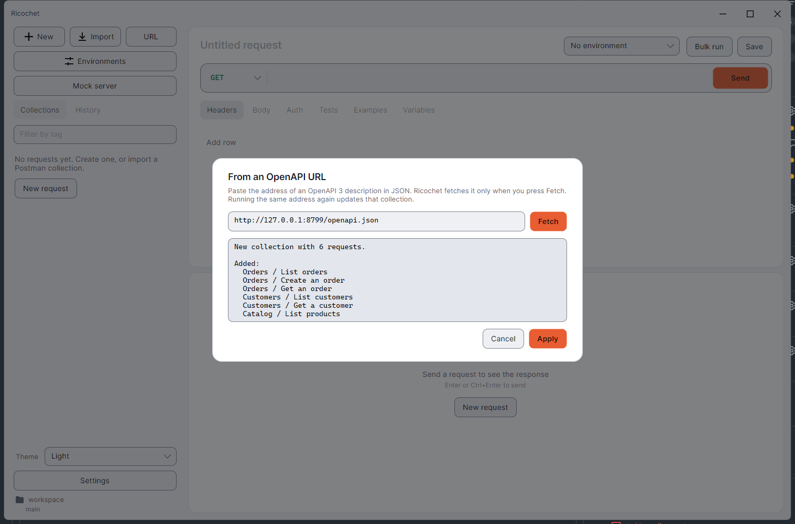
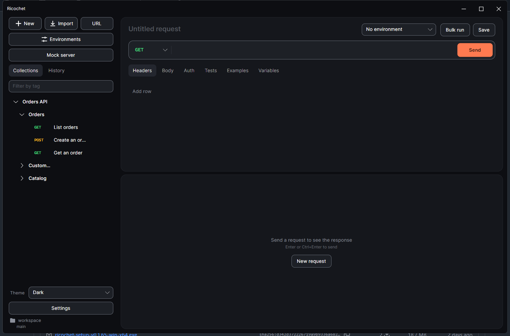
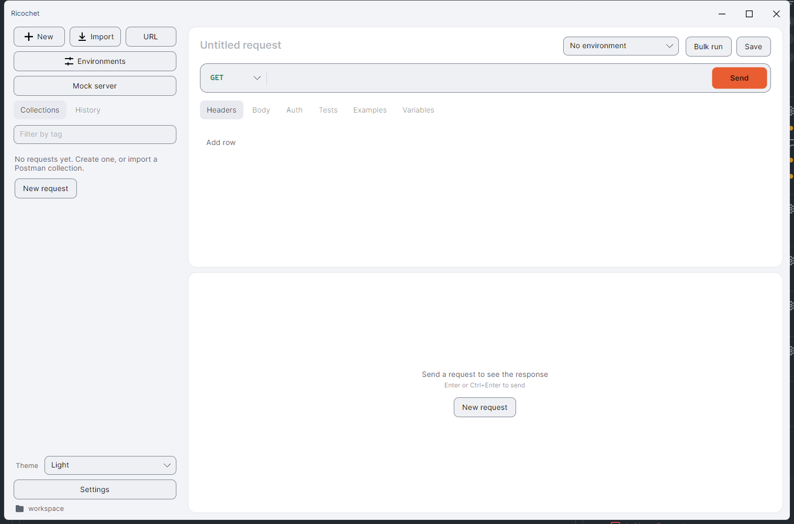
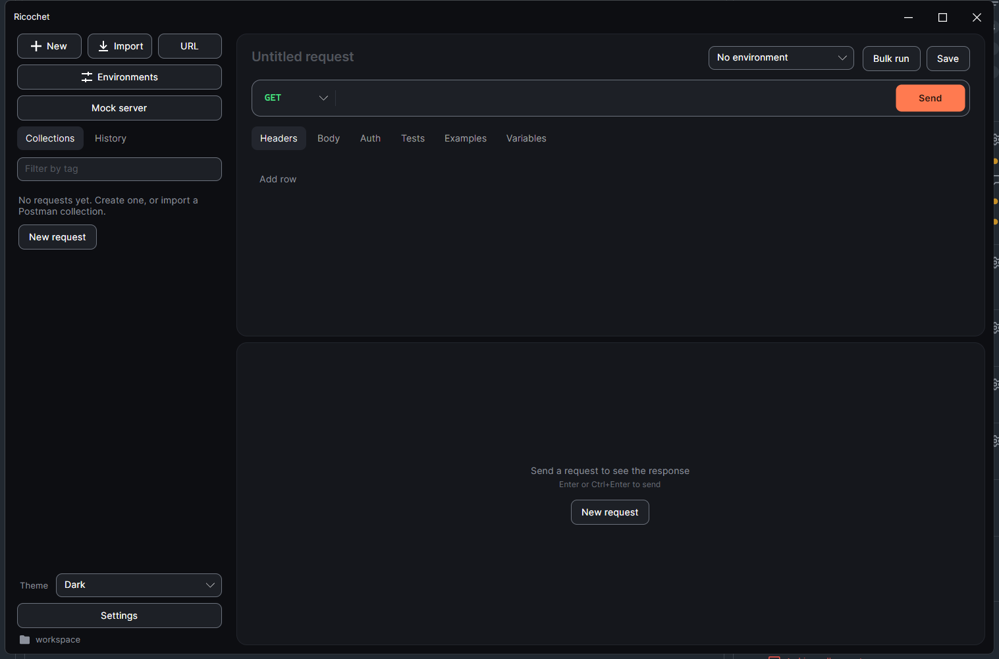
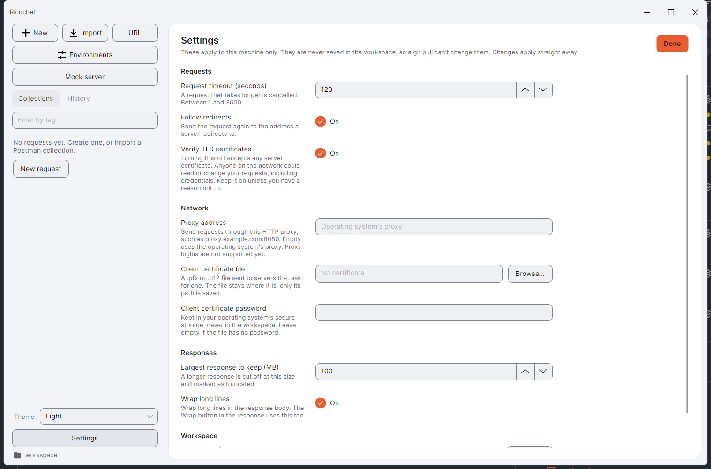
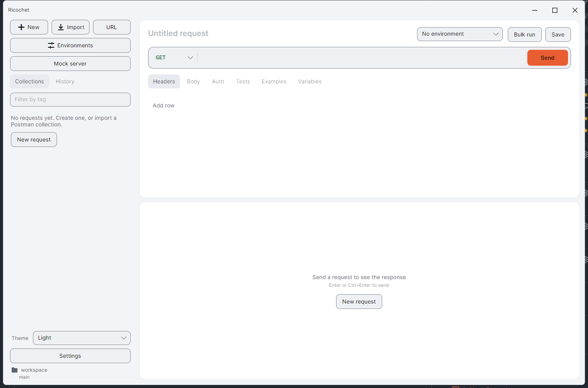

# Ricochet


A fast, native desktop HTTP client for Windows, macOS and Linux, built with C#, Avalonia and Native AOT.

- Decisions: [docs/adr](docs/adr)
- Vocabulary: [GLOSSARY.md](GLOSSARY.md)

## Features

- Send requests with headers, bodies, and bearer, basic, API key, Digest, OAuth 1.0 or AWS Signature v4 auth.
- Refuse header values that contain a line break, so a value can't add headers of its own.
- Organise requests into collections and folders, with environments and scoped `{{variables}}`.
- Warn about a `{{` that is never closed. The command line runner fails such a request without sending it.
- Open several requests as tabs. Press Ctrl+K (Cmd+K on macOS) for a palette of actions and requests, or Ctrl+P for requests only.
- Hide folders and requests you aren't using, without deleting them.
- Keep secrets in your operating system's secure storage.
- Add tests to a request, and save values from a response for later requests.
- Import Postman exports, or create a collection from an OpenAPI 3 description.
- Run a workspace from the command line in CI.
- Follow the light or dark theme of your system.

## Install on Windows

Download `ricochet-setup-<version>-win-x64.exe` from the [latest release](https://github.com/Hamelatoire/ricochet-dotnet/releases/latest) and run it. The installer puts Ricochet in your own programs folder, so it needs no administrator rights. It can also add a desktop shortcut and put the `ricochet` command on your `PATH`, and both are off until you choose them. Uninstalling removes the program and leaves your workspace and settings alone.

Release builds aren't signed yet, so Windows may warn before running the installer. The zips for each platform on the same page need no installer.

## Test your APIs

Add checks to a request in its **Tests** tab, such as "Status equals 200" or "JSON value `items[0].id` exists". They run every time you send it, and the results appear beside the response. Save the request to keep them. See [ADR 0006](docs/adr/0006-declarative-tests-not-scripts.md) for why these are checks rather than scripts.

Paths for JSON values look like `items[0].name` or `$.a['b.c']`, and `items.length` counts an array. Expected values can use `{{variables}}`.

To chain requests, add a saved value in the same tab. For example, on a login request, save the JSON value `data.token` as `token`, then use `{{token}}` in later requests in that collection. Saved values stay in memory and are never written to a file. In the app they last until you close it, so send the login again after a restart, and you can see their names or clear them under **Variables > Saved**.

Mark a variable **Prompt** and Ricochet asks for its value each time you send the request. The value is used for that send only and is never saved. See [ADR 0019](docs/adr/0019-prompt-for-a-variable-when-a-request-is-sent.md).

## Import from Postman

Export your collections (v2.0 or v2.1), environments and globals from Postman as JSON, then choose **Import** and select the files. You can also pick Postman's data dump (a `.zip`) and choose which of its collections to import. The results list everything that could not be carried over. Scripts are kept but not run, and OAuth 2 and file uploads are not imported yet. See [ADR 0002](docs/adr/0002-import-postman-exports.md) for details.

## Collections from an OpenAPI URL

Click **URL** in the sidebar, paste the address of an OpenAPI 3 description in JSON, and press **Fetch**. Ricochet shows what it will add or change before you press **Apply**. Each operation becomes a request, grouped into folders by tag. Running the same address again updates that collection and keeps the headers, bodies, tests and saved values you added. See [ADR 0014](docs/adr/0014-collections-from-openapi-url.md).

| Preview before applying | Orders API, imported and grouped by tag |
| --- | --- |
|  |  |

## Hide folders and requests

Hover over a folder or request in the sidebar and click its hide icon. It stays in the workspace, and **Show hidden** on the collection brings it back. The choice is saved in the collection's file, so it is shared through git, and the command-line runner skips hidden folders and requests. See [ADR 0032](docs/adr/0032-hide-a-folder-without-deleting-it.md).

## Mock server

Choose **Mock server** in the sidebar to answer requests on this computer from an OpenAPI description. It listens on `127.0.0.1` only. See [ADR 0027](docs/adr/0027-mock-servers-built-from-examples-or-an-openapi-description.md).

## Themes

Ricochet follows your system's light or dark setting. Choose **System**, **Light** or **Dark** in the Theme box at the bottom of the sidebar. See [ADR 0013](docs/adr/0013-light-and-dark-theme.md).

| Light | Dark |
| --- | --- |
|  |  |

## Settings

Choose **Settings** at the bottom of the sidebar for preferences that stay on this machine: request timeout, following redirects, a proxy, a client certificate and its password, certificate checks, the largest response to keep, and wrapping long lines. They are never saved in the workspace, so a `git pull` cannot change them. The certificate password is kept in your operating system's secure storage. While certificate checks are off, a warning shows on every page. See [ADR 0007](docs/adr/0007-personal-settings-page.md) and [ADR 0026](docs/adr/0026-proxy-and-client-certificates-for-requests.md).



## Git branch

When the workspace folder is a git repository, the sidebar shows its branch under the folder name, with commits ahead and behind its upstream. Ricochet only reads this, using the git on your computer. It never fetches, commits or pushes, so the counts reflect what git last fetched. See [ADR 0011](docs/adr/0011-read-only-git-status.md).



## Run in CI

The `ricochet` command runs a workspace's requests and checks. A run only reads the workspace; `export` writes only the file you name. Build it with:

```bash
dotnet publish src/Ricochet.Cli -c Release -r win-x64 -o publish/cli-win-x64
```

Then run it from a workspace folder, or give it the path:

```bash
ricochet run --env Staging --xunit results.xml
```

It exits with `0` if everything passed, `1` if a request or check failed, and `2` if the run couldn't happen. These count as `2` rather than passing, because a green result would be misleading: unreadable files such as ones with merge conflicts, and selections that match nothing. If hiding leaves nothing to run, it exits with `2` too.

A request needing a variable with no value fails without being sent. Secrets aren't in the repository, so provide them through environment variables named `RICOCHET_VAR_<name>`, for example `RICOCHET_VAR_token`. These and saved values are masked in the output and the report, but only when the value is at least 4 characters long.

For a local run, a `.env` file in the workspace folder works too, with `KEY=VALUE` lines. Environment variables override it, and `--var` overrides both. Ricochet doesn't write these values anywhere, and new workspaces list `.env` in their `.gitignore`.

Requests run in order, and saved values carry forward within a collection. Running only one folder won't include a login request outside it, so its requests fail without being sent. Postman scripts aren't run, so the summary says how many requests had any.

Folders can have tags, which their requests inherit. `--tag smoke` runs only requests with that tag, and `--exclude-tag slow` skips them. Both can repeat, and a request with an excluded tag is skipped even when it has an included one. A selection that matches nothing exits with `2`.

`--data <file>` runs the collection once per row of a `.csv` or `.json` file. Each row's columns become variables for that run, and each run's results are printed under its row number. See [ADR 0018](docs/adr/0018-run-a-collection-once-per-row-of-a-csv-or-json-data-file.md).

`ricochet export <collection> --postman <file>` writes a Postman v2.1 collection, and `--openapi <file>` writes an OpenAPI 3 document. Give both to write both. Secret values are never written, and `--force` replaces an existing file. See [ADR 0029](docs/adr/0029-export-a-collection-to-postman-and-openapi.md).


On Windows, Smart App Control can block a newly built `ricochet.exe` because it's unsigned. Signing release builds is the lasting fix. In development, you can run the same code with `dotnet run --project src/Ricochet.Cli -- run`.

## Your data

Your work is stored as a folder of small JSON files, one per request, so it can be shared through git. By default that folder is in your user application data (`%APPDATA%\Ricochet\workspace` on Windows). To keep it in a repository, choose **Change…** at the bottom of the sidebar and pick a folder: a folder without a workspace gets a copy after you confirm, and one that has a workspace is opened. If files change while Ricochet is open, for example after a `git pull`, it reloads them. Files it can't read, such as one with merge conflict markers, are reported and left untouched.

History, the active environment and secrets stay in your personal application data and are never written to the shared folder. Set `RICOCHET_DATA` to use a different personal folder.

For what Ricochet stores and sends, see the [user data policy](docs/PRIVACY.md).

Values you mark as **Secret**, and values typed into auth fields, are kept out of that file and in your system's secure storage instead: DPAPI on Windows, Keychain on macOS, and Secret Service on Linux (which needs `secret-tool` from `libsecret-tools`). The macOS and Linux versions have not been tested yet. If secure storage isn't available, Secrets last only until you close the app, and Ricochet tells you so.

**Everything else in the workspace folder is plain text, and is shared if you commit it.** That includes other variables and any credentials typed directly into a header or URL, though Ricochet warns you when it spots one. Use a `{{variable}}` marked Secret for these. History hides common credential headers.

## Build from source

Requires the .NET 10 SDK.

```bash
dotnet run --project src/Ricochet.App
```

```bash
dotnet test --project tests/Ricochet.Core.Tests
```

To build a native app, run this on the operating system you are building for, because Native AOT does not cross-compile between them. Replace `win-x64` with `osx-arm64` or `linux-x64` as needed.

```bash
dotnet publish src/Ricochet.App -c Release -r win-x64 -o publish/win-x64
```

Native AOT needs a platform linker: the Visual Studio C++ build tools on Windows, Xcode command line tools on macOS, and clang on Linux.

On Windows, if linking fails with `'vswhere.exe' is not recognized`, add `C:\Program Files (x86)\Microsoft Visual Studio\Installer` to your `PATH`.

## Release

Merging a pull request into `main` runs the tests and builds the app and the CLI on Windows, Linux and macOS, then attaches them to a GitHub release with the next patch version, such as `v0.1.1`. The Windows build also gets an installer, made from `installer/ricochet.iss` with [Inno Setup](https://jrsoftware.org/isinfo.php). The pull request check builds it too, so a change that breaks it is found before it merges.

To choose the version yourself, such as a new minor version, push a tag instead:

```bash
git tag v0.2.0
```

```bash
git push origin v0.2.0
```

The builds are not code signed, so Windows and macOS may warn about them or block them.
