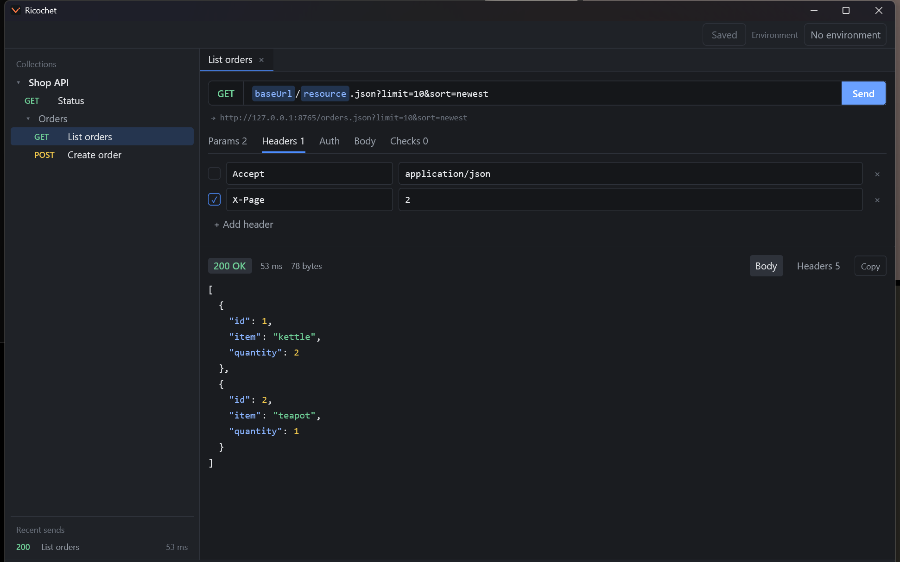
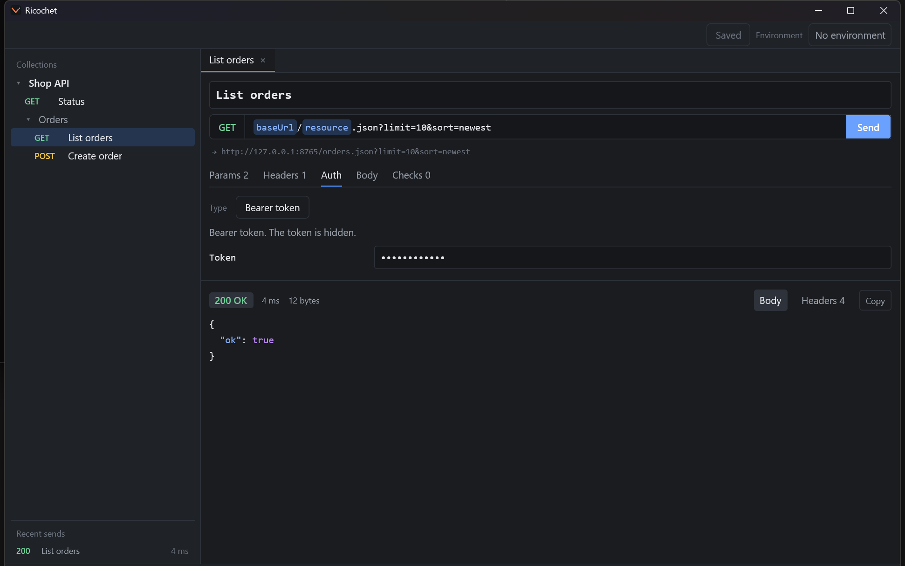
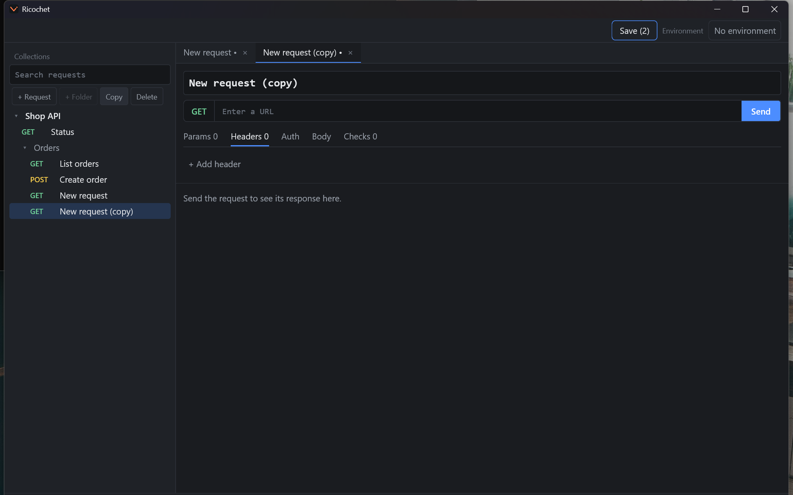
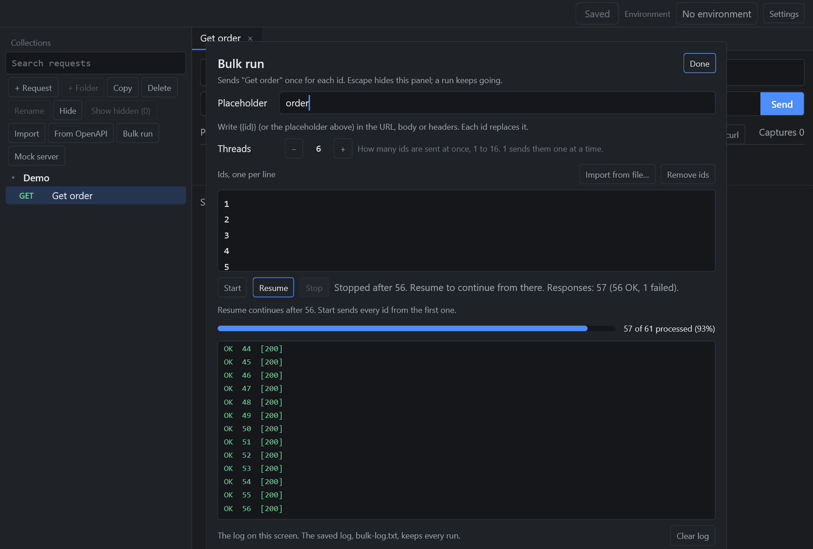
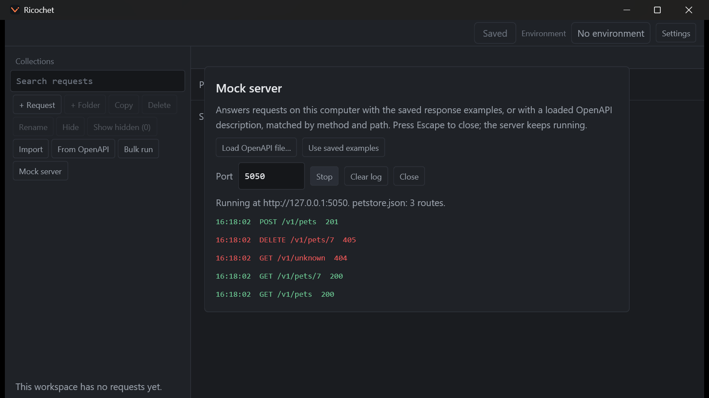
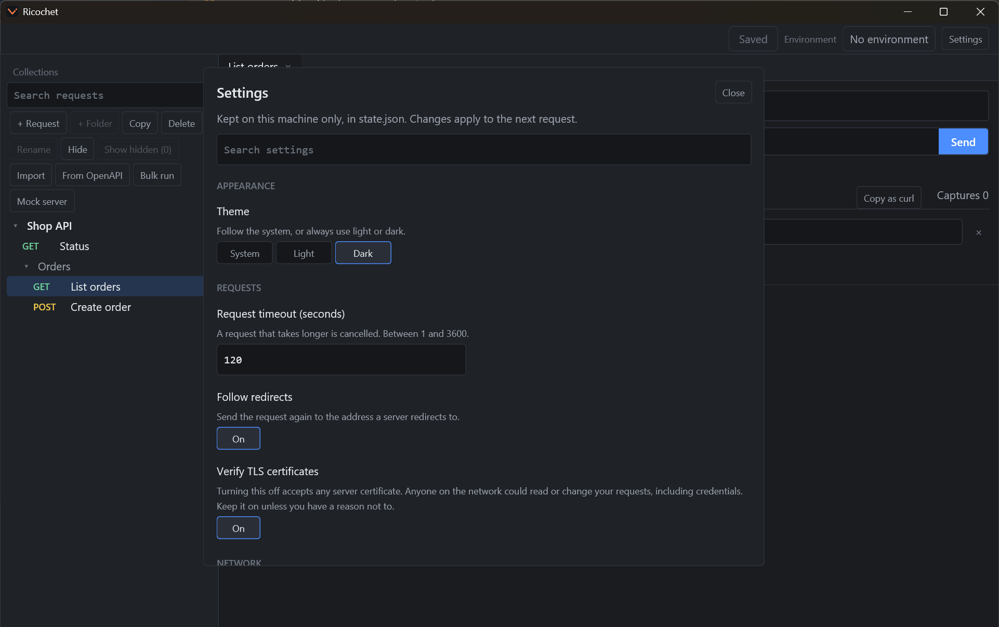
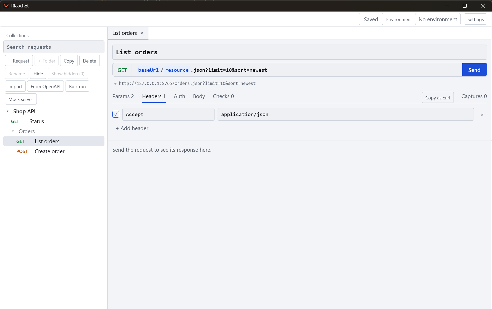
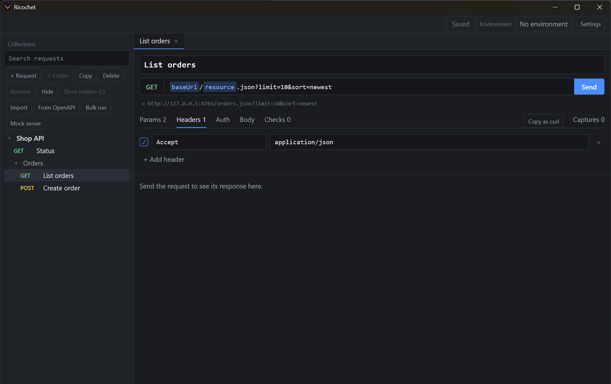

# Ricochet


A fast, native desktop HTTP client for Windows, macOS and Linux, with a `ricochet` command for CI. Your work is a folder of small JSON files you can keep in git, and nothing is sent anywhere you didn't ask for.

Ricochet is written in Rust with [GPUI](https://www.gpui.rs). [ADR 0091](docs/adr/0091-rebuild-in-rust-with-gpui.md) records why it was rebuilt from C#.

- Decisions: [docs/adr](docs/adr)
- Vocabulary: [GLOSSARY.md](GLOSSARY.md)
- What Ricochet stores and sends: [docs/PRIVACY.md](docs/PRIVACY.md)

## Contents

- [Install](#install-on-windows) · [Your data](#your-data)
- [A tour of the window](#a-tour-of-the-window)
- [Send a request](#send-a-request) · [Authentication](#authentication) · [Variables and environments](#variables-and-environments)
- [Test and chain requests](#test-and-chain-requests) · [The response](#the-response)
- [Organise your work](#organise-your-work) · [Find things fast](#find-things-fast)
- [Import and export](#import-and-export) · [Bulk run](#bulk-run) · [Mock server](#mock-server)
- [Settings](#settings) · [Themes](#themes) · [Run in CI](#run-in-ci) · [Build from source](#build-from-source)



## Install on Windows

Download `ricochet-setup-<version>-win-x64.exe` from the [latest release](https://github.com/Hamelatoire/ricochet-http-client/releases/latest) and run it. The installer puts Ricochet in your own programs folder, so it needs no administrator rights. It can also add a desktop shortcut and put the `ricochet` command on your `PATH`, and both are off until you choose them. Uninstalling removes the program and leaves your workspace and settings alone.

Release builds aren't signed yet, so Windows may warn before running the installer. The zips and tarballs for each platform on the same page need no installer.

## Your data

Your work is stored as a folder of small JSON files, one per request, so it can be shared through git. By default that folder is in your user application data (`%APPDATA%\Ricochet\workspace` on Windows). To keep it in a repository, open or copy the workspace to another folder from the app. If files change while Ricochet is open, for example after a `git pull`, it reloads them. Files it can't read, such as one with merge conflict markers, are reported and left untouched.

History, the active environment and secrets stay in your personal application data and are never written to the shared folder. Set `RICOCHET_DATA` to use a different personal folder. For what Ricochet stores and sends, see the [user data policy](docs/PRIVACY.md).

Values you mark as **Secret**, and values typed into auth fields, are kept out of the workspace and in your system's secure storage instead: DPAPI on Windows, Keychain on macOS, and Secret Service on Linux (which needs `secret-tool` from `libsecret-tools`). Only Windows has been tested. If secure storage isn't available, Secrets last only until you close the app, and Ricochet tells you so. See [ADR 0092](docs/adr/0092-secrets-in-the-rust-port.md).

**Everything else in the workspace folder is plain text, and is shared if you commit it.** That includes other variables and any credentials typed directly into a header or URL, though Ricochet warns you when it spots one. Use a `{{variable}}` marked Secret for these. History hides common credential headers.

## A tour of the window

- **Top bar:** the **Save** button, which shows how many changes are unsaved, the **Environment** picker, and **Settings**.
- **Sidebar:** a search field, the buttons for working with requests, the tree of collections and folders, and **Recent sends**, your history.
- **Tabs:** every request you open gets a tab. A dot after its name means it has unsaved changes.
- **Request editor:** the name, the method, the URL and **Send**, with tabs below for **Params**, **Headers**, **Auth**, **Body**, **Checks** and **Captures**.
- **Response pane:** under the editor, with the status, the time, the size, and the body and headers.
- **Status bar:** the git branch of the workspace folder and the folder you have open. Ricochet only reads git, and never fetches, commits or pushes.

Ricochet remembers its window size and position.

## Send a request

Choose **+ Request** in the sidebar, or press Ctrl+N (Cmd+N on macOS). Type a name, pick a method, enter a URL and press **Send** or Ctrl+Enter.

- **URL and Params:** the line under the URL shows the address that will really be sent, with every `{{variable}}` replaced. Query parameters appear on the **Params** tab.
- **Headers:** add rows with **+ Add header**. Untick a row to keep it without sending it. A header value that contains a line break is refused, so a value can't add headers of its own.
- **Body:** type the body as text. A `{{variable}}` inside a JSON body is escaped, so a value with a quote can't break it.
- **Copy as curl:** copies the request as a `curl` command, found beside the request tabs.
- **Warnings:** if a variable has no value, or a `{{` is never closed, Ricochet tells you and still sends. The command line runner fails such a request without sending it.

## Authentication

On the **Auth** tab, choose **No auth**, **Bearer token**, **Basic**, **API key**, **Digest**, **OAuth 1.0** or **AWS Signature v4**. Passwords, tokens and secrets are hidden after you type them. They are kept in your system's secure storage and never written to the workspace files. See [Your data](#your-data).



## Variables and environments

Write `{{name}}` anywhere in a URL, header, body or auth field. Names are highlighted in the URL bar, so you can see what will be replaced.

A variable gets its value from the layers below. A later layer overrides an earlier one with the same name:

1. **Globals:** variables that belong to the whole workspace, such as ones imported from Postman.
2. **Collection variables:** the defaults, set on a collection.
3. **Folder variables:** a folder's variables apply to the requests inside it, and a nearer folder overrides one further out. See [ADR 0020](docs/adr/0020-folder-level-variables.md).
4. **The active environment:** a set of values you choose from the **Environment** picker, such as Staging or Production.
5. **Your `.env` file** in the workspace folder, for local runs. It wins over everything above, so it is a good place for a personal token.

A variable marked **Prompt** asks for a value each time you send, and the value is used for that send only and is never saved. See [ADR 0019](docs/adr/0019-prompt-for-a-variable-when-a-request-is-sent.md). Values can refer to other variables, so a `baseUrl` variable can itself contain `{{host}}`.

**Create an environment:** open the **Environment** picker and choose **+ New environment**. It opens in the editor, where you rename it and set a value for each variable of the collection. A value typed there overrides the default, and an empty value uses the default. Save to keep it. **Edit environments** reopens it later. Press Ctrl+E (Cmd+E) to switch environment from the keyboard, or use the command palette.

Mark a variable **Secret** to keep its value out of the workspace files. The environment you picked is remembered between runs, but it is kept in your personal data and not in the shared folder, so a teammate's choice never changes yours.

## Test and chain requests

Add checks to a request in its **Checks** tab, with **+ Add check**. A check compares part of the response with a value, for example "status equals 200" or "JSON value `items[0].id` exists". Save the request to keep them. See [ADR 0006](docs/adr/0006-declarative-tests-not-scripts.md) for why these are checks rather than scripts.

Paths for JSON values look like `items[0].name` or `$.a['b.c']`, and `items.length` counts an array. Expected values can use `{{variables}}`.

To chain requests, add a saved value in the **Captures** tab with **+ Add saved value**. For example, on a login request, save the JSON value `data.token` as `token`, then use `{{token}}` in later requests in that collection. Saved values stay in memory and are never written to a file.

Checks and saved values run when you run a whole collection: choose **Run collection** in the command palette (Ctrl+K), and the summary appears in the status bar. A list of results for each request is not in the window yet. For the full results, run the same workspace with `ricochet run` (see [Run in CI](#run-in-ci)). A single **Send** in the window doesn't run checks or carry saved values between sends yet.

## The response

The response pane shows the status, the time, the size, and the body, formatted and coloured when it is JSON. **Headers** lists the response headers, and **Copy** copies the body.

- **Save example** stores the response with the request, so it is kept in the request's file. The [mock server](#mock-server) can answer from these saved examples.
- **Compare** shows the last two responses of a request side by side, with the changed lines tinted. It is handy for spotting what an API change did.
- If a body was larger than the limit in Settings, Ricochet says it was cut. If you turned certificate checks off, it tells you on every send.

## Organise your work



- **+ Request** and **+ Folder** add to the selected collection or folder. Folders can nest.
- **Copy** duplicates the selected request or folder, and **Rename** renames it.
- **Delete** asks you to press it a second time before anything is deleted.
- **Hide** takes a folder or request out of view without deleting it. **Show hidden (n)** brings them back. The choice is saved in the collection's file, so it is shared through git, and the command line runner skips hidden items. See [ADR 0032](docs/adr/0032-hide-a-folder-without-deleting-it.md).
- **Tags:** give a folder tags, separated by commas. Its requests inherit them, and the command line runner can select by tag.
- **Save** (Ctrl+S) writes your changes. The button shows how many are waiting.
- If files change while Ricochet is open, for example after a `git pull`, it says "The folder changed on disk." and reloads them. Files it can't read, such as one with merge conflict markers, are reported and left alone.

## Find things fast

- **Search requests** in the sidebar filters the tree as you type. Ctrl+P (Cmd+P) jumps to it.
- **Command palette:** Ctrl+K (Cmd+K) lists actions and requests: send, save, close tabs, switch environment, run a collection, start a bulk run, and export a collection as Postman or OpenAPI.
- **Recent sends** at the bottom of the sidebar lists what you sent lately, with its status and time. History hides common credential headers.
- **Ctrl+/** (Cmd+/) opens the **Keyboard shortcuts** sheet.

| Shortcut | Action |
| --- | --- |
| Ctrl+Enter | Send the request |
| Ctrl+S | Save |
| Ctrl+N | New request |
| Ctrl+K | Command palette |
| Ctrl+P | Find a request |
| Ctrl+L | Focus the URL |
| Ctrl+E | Switch environment |
| Ctrl+W | Close the tab |
| Ctrl+Tab, Ctrl+Shift+Tab | Next and previous tab |
| Ctrl+/ | Show all shortcuts |

On macOS, use Cmd in place of Ctrl.

## Import and export

**Import** in the sidebar reads files from other tools:

- **Postman:** export your collections (v2.0 or v2.1), environments and globals as JSON, then select the files. You can also pick Postman's data dump (a `.zip`) and choose which of its collections to import, one dump at a time. See [ADR 0002](docs/adr/0002-import-postman-exports.md).
- **Insomnia:** import an Insomnia export.
- **What could not be carried over** is listed in a report when the import finishes. Scripts are kept but not run, and OAuth 2 and file uploads are not imported yet. Imported items aren't on disk until you **Save**.

**From OpenAPI** builds a collection from an OpenAPI 3 description. Paste the address of a description in JSON and fetch it. Ricochet shows what it will add or change before you apply it. Each operation becomes a request, grouped into folders by tag. Running the same address again updates that collection and keeps the headers, bodies, checks and saved values you added. See [ADR 0014](docs/adr/0014-collections-from-openapi-url.md).

To get work out of Ricochet, choose **Export collection as Postman** or **Export collection as OpenAPI** in the command palette. The command line can also document a collection as a web page or archive a whole workspace. See [Run in CI](#run-in-ci).

## Bulk run



**Bulk run** sends the selected request once for each id you give it.

1. Choose the request, then **Bulk run**.
2. Set the **Placeholder**, for example `order`, and write `{{order}}` in the URL, body or headers of the request.
3. Type the ids, one per line, or use **Import from file…**. **Remove ids** clears them.
4. Set **Threads** from 1 to 16 to send several at once. 1 sends them one at a time.
5. Press **Start**. A progress bar and a log show every response.

**Stop** ends a run, and **Resume** continues after the last id that finished. Escape hides the panel while a run keeps going. The log on screen shows the recent lines, and the saved `bulk-log.txt` keeps every run. See [ADR 0015](docs/adr/0015-bulk-runs-with-resume.md).

## Mock server



**Mock server** answers requests on this computer. It listens on `127.0.0.1` only, so nothing outside your machine can reach it.

- **Use saved examples** answers from the responses you saved with **Save example**, matched by method and path.
- **Load OpenAPI file…** answers from an OpenAPI description instead.
- Pick a **Port** (5050 to start), then **Start**. The log lists each request with its status. **Clear log** empties it, and the server keeps running when you close the panel.

See [ADR 0027](docs/adr/0027-mock-servers-built-from-examples-or-an-openapi-description.md).

## Settings



**Settings** holds preferences that stay on this machine, in `state.json`. They are never saved in the workspace, so a `git pull` cannot change them. Changes apply to the next request, and a search field at the top filters them.

- **Appearance:** **System**, **Light** or **Dark**.
- **Requests:** the request timeout (1 to 3600 seconds, 120 by default), and whether to follow redirects.
- **Network:** a proxy address (empty uses the system proxy), and a client certificate file and its password. The certificate must be a PEM file holding the certificate and an unencrypted key. The password is kept in your system's secure storage.
- **Verify TLS certificates:** leave it on unless you have a reason. While it is off, every send says so.
- **Responses:** the largest response to keep, in MB, and whether to wrap long lines.
- **Privacy:** the crash log folder. After a crash the app writes a log there. It stays on this machine and is never sent anywhere. Exception messages and request data are left out, but file paths may include your user name.
- **Workspace:** open another workspace folder, or copy the current one to a new folder after you confirm.

See [ADR 0007](docs/adr/0007-personal-settings-page.md) and [ADR 0026](docs/adr/0026-proxy-and-client-certificates-for-requests.md).

## Themes

Ricochet follows your system's light or dark setting. Choose **System**, **Light** or **Dark** in Settings, under Appearance. See [ADR 0013](docs/adr/0013-light-and-dark-theme.md).

| Light | Dark |
| --- | --- |
|  |  |

## Run in CI

The `ricochet` command runs a workspace's requests and checks. A run only reads the workspace. Build it with:

```bash
cargo build --release --manifest-path rust/ricochet-cli/Cargo.toml
```

Then run it from a workspace folder, or give it the path:

```bash
ricochet run --env Staging --xunit results.xml
```

It exits with `0` if everything passed, `1` if a request or check failed, and `2` if the run couldn't happen. These count as `2` rather than passing, because a green result would be misleading: unreadable files such as ones with merge conflicts, and selections that match nothing.

A request needing a variable with no value fails without being sent. Secrets aren't in the repository, so provide them through environment variables named `RICOCHET_VAR_<name>`, for example `RICOCHET_VAR_token`. For a local run, a `.env` file in the workspace folder works too, with `KEY=VALUE` lines. Environment variables override it, and `--var` overrides both. These values and saved values are masked in the output and the report.

Requests run in order, and saved values carry forward within a collection. Folders can have tags, which their requests inherit: `--tag smoke` runs only requests with that tag, and `--exclude-tag slow` skips them. `--data <file>` runs the collection once per row of a `.csv` or `.json` file. See [ADR 0018](docs/adr/0018-run-a-collection-once-per-row-of-a-csv-or-json-data-file.md).

Other commands, each with its own `--help`:

- `ricochet export <collection> --postman <file>` or `--openapi <file>` writes a Postman v2.1 collection or an OpenAPI 3 document. Secret values are never written. See [ADR 0029](docs/adr/0029-export-a-collection-to-postman-and-openapi.md).
- `ricochet env export` and `ricochet env import` move an environment through a JSON file.
- `ricochet docs <collection> <file.html>` writes a page documenting a collection.
- `ricochet zip export` and `ricochet zip import` archive and restore a workspace.
- `ricochet clone <git-url> <folder>` clones a workspace from git.

On Windows, Smart App Control can block a newly built `ricochet.exe` because it's unsigned. Signing release builds is the lasting fix.

## Build from source

You need a stable Rust toolchain. The three crates under [`rust/`](rust) are not a Cargo workspace, so run Cargo with `--manifest-path`:

- `ricochet-core` holds the behaviour: the data model, variables, sending, checks, the runner, import and export, the mock server and the secret vaults.
- `ricochet-app` is the window.
- `ricochet-cli` is the command line.

Set `RICOCHET_DATA` to a temporary folder first, so you don't try the app on your real data.

```bash
cargo run --manifest-path rust/ricochet-app/Cargo.toml
```

```bash
cargo test --manifest-path rust/ricochet-core/Cargo.toml
```

```bash
cargo test --manifest-path rust/ricochet-cli/Cargo.toml
```

```bash
cargo test --manifest-path rust/ricochet-app/Cargo.toml
```

On Linux, GPUI needs the development packages for Wayland, X11 and Vulkan. The CI workflows in [`.github/workflows`](.github/workflows) list the ones they install.

## Release

Merging a pull request into `main` runs the tests and builds the app and the command line on Windows, Linux and macOS, then attaches them to a GitHub release with the next patch version, such as `v0.1.1`. The Windows build also gets an installer, made from `installer/ricochet.iss` with [Inno Setup](https://jrsoftware.org/isinfo.php). The pull request check builds it too, so a change that breaks it is found before it merges.

To choose the version yourself, such as a new minor version, push a tag instead:

```bash
git tag v0.2.0
```

```bash
git push origin v0.2.0
```

The builds are not code signed, so Windows and macOS may warn about them or block them.
